# e-Peddlers – La Carlota City Peddler Business Permit Application and Management System

[](#)
[](#)
[](#)
[](#)
[](#)
[](#)
[](#)

---

## 1. System Overview

**e-Peddlers** is a complete, enterprise-grade hybrid web and mobile application engineered for the Local Government Unit of **La Carlota City, Negros Occidental, Philippines**. It digitalizes the end-to-end peddler business permit application lifecycle, sequential inter-departmental approvals, statutory fee assessment, PayMongo QRPh & Treasury cash collection, official permit generation, weekly market **Arkabala** collection, and ordinance violation management.

---

## 2. Platform Access Control Matrix

The system enforces strict role-based platform separation at both backend (`PlatformMiddleware.php`) and frontend layers:

| Role | Web Application | Mobile Application | Authentication Method | Primary Responsibilities |
|---|:---:|:---:|---|---|
| **Admin** |  **YES** |  **NO** | Email / Password | System admin, initial application review, permit release, fee schedule, user management, audit logs |
| **Treasury** |  **YES** |  **NO** | Email / Password | Cash payment verification, PayMongo QRPh validation, Arkabala reconciliation, financial reports |
| **Sanitary** |  **NO** |  **YES** | Email / Password | Health certificate and sanitary compliance inspection, mobile review & decision |
| **Inspector** |  **NO** |  **YES** | Email / Password | On-site requirement inspection (Price tag, sample products, clearance), Arkabala QR camera scanner, cash collection, violation issuance |
| **Peddler** |  **YES** |  **YES** | Passwordless Peddler ID / Phone / Email + OTP | Permit application submission & renewal, digital permit viewing, Arkabala QR pass display, payment history, violation tracking |

> **Security Rule**: Attempts by Admin or Treasury to authenticate via the mobile app, or by Sanitary or Inspector to authenticate via the web app, return HTTP `403 Forbidden` with audit logging.

---

## 3. Pre-Seeded User Credentials & Portal Routes

### Web Application Routes:
- **Public Citizen / Peddler Landing Page**: `http://localhost:5173/` (Features, Live Application Tracker, Fee Formula, Ordinance summary)
- **Peddler Self-Service Sign In**: `http://localhost:5173/peddler-login` (Passwordless Peddler ID + OTP)
- **Official Staff Portal (Hidden from Public View)**: `http://localhost:5173/staff-login` (Authorized Administrator & City Treasury access)

### Mobile Application Access:
- **Default View**: Peddler Portal (OTP Sign In)
- **Separate Inspector Sign In**: Dedicated button for Market Inspectors with Arkabala camera scanner
- **Separate Sanitary Sign In**: Dedicated button for City Health Sanitary inspectors

| Role | Email / Identifier | Password / OTP | Access Platform | Route / Mode |
|---|---|---|---|---|
| **Admin** | `admin@lacarlota.gov.ph` | `Admin@12345` | Web Only | `/staff-login` |
| **Treasury** | `treasury@lacarlota.gov.ph` | `Treasury@12345` | Web Only | `/staff-login` |
| **Sanitary** | `sanitary@lacarlota.gov.ph` | `Sanitary@12345` | Mobile Only | "Sanitary Officer" button |
| **Inspector** | `inspector@lacarlota.gov.ph` | `Inspector@12345` | Mobile Only | "Market Inspector" button |
| **Peddler (Sample 1)** | `PED-2026-0001` or `juan.delacruz@example.com` | OTP: `123456` (or test auto-code) | Web & Mobile | `/peddler-login` / Peddler Mode |
| **Peddler (Sample 2)** | `PED-2026-0002` or `maria.santos@example.com` | OTP: `123456` (or test auto-code) | Web & Mobile | `/peddler-login` / Peddler Mode |

---

## 4. Statutory Permit Fee Structure & Formula

Permit fee assessment is governed by the official City Ordinance fee schedule:

$$\text{Total Fee} = \text{Fixed Base Fees (₱540.00)} + (\text{Total Units} \times ₱110.00) + \text{Late Penalty (₱200.00 if applicable)}$$

### Breakdown:
1. **Fixed Base Sum: ₱540.00**
   - Mayor's Permit Fee: ₱110.00
   - Sanitary Inspection Permit: ₱55.00
   - Health Certificate: ₱110.00
   - Garbage Service Fee: ₱55.00
   - Barangay Clearance Verification: ₱10.00
   - Peddler's Regulatory Tax: ₱200.00
2. **Occupational Tax: ₱110.00 per unit**
   - Total Units = `num_papag` + `num_lag_it`
3. **Late Renewal Penalty: ₱200.00**
   - Imposed if application renewal is filed more than 1 month past January 31 deadline.

### Example Calculations:
- **1 Papag, 0 Lag-it (On-time)**: ₱540.00 + (1 × ₱110.00) = **₱650.00**
- **2 Papag, 1 Lag-it (Late Renewal)**: ₱540.00 + (3 × ₱110.00) + ₱200.00 = **₱1,070.00**

---

## 5. 5-Stage Sequential Approval Workflow

```mermaid
flowchart LR
    A["Peddler Submits Application"] --> B["Stage 1: Admin Review"]
    B -->|"Approved (Generates PED ID)"| C["Stage 2: Inspector Review"]
    B -->|"Rejected (Mandatory Reason)"| A
    C -->|"Compliant (Price tag, sample products)"| D["Stage 3: Sanitary Inspection"]
    C -->|"Non-compliant"| A
    D -->|"Sanitary Approved"| E["Stage 4: Treasury Payment"]
    D -->|"Sanitary Rejected"| A
    E -->|"Cash / PayMongo QRPh Verified"| F["Stage 5: Admin Permit Release"]
    F -->|"RELEASE PERMIT"| G["FINISHED (PERMIT-YYYY-XXXX & Arkabala QR Active)"]
```



---

## 6. Project Architecture

```
e-Peddlers/
├── backend/                  # PHP REST API & Database
│   ├── api/                  # API entry point (index.php)
│   ├── config/               # Database PDO singleton, .env, CORS
│   ├── controllers/          # 12 REST Controllers
│   ├── database/             # schema.sql (34 tables), seed.sql, setup.php
│   ├── helpers/              # Response, JWT, CodeGenerator, Validator, Logger
│   ├── middleware/           # AuthMiddleware, PlatformMiddleware, RoleMiddleware
│   ├── services/             # FeeCalculator, PayMongo, Email (PHPMailer), Socket, PDF
│   ├── tests/                # verify_all.php (27-step automated test suite)
│   └── uploads/              # Document attachments, QR codes, violations
├── realtime/                 # Node.js Socket.IO Server (Port 3001)
│   ├── package.json
│   └── server.js             # Realtime broadcaster & room management
├── web/                      # React 19 + Vite 8 + Tailwind CSS v4 Desktop Portal
│   ├── src/
│   │   ├── components/       # Modals, Timelines, SignaturePad, PayMongoModal, Badges
│   │   ├── context/          # AuthContext, ToastContext, SocketContext
│   │   ├── layouts/          # AdminLayout, TreasuryLayout, PeddlerLayout
│   │   ├── pages/            # Admin, Treasury, Peddler dashboards & workflows
│   │   └── services/         # Axios client, formatters, constants
├── epeddlers-mob/            # React Native Expo Mobile Application
│   ├── src/
│   │   ├── app/              # Root index router & role navigator
│   │   ├── screens/          # LoginScreen, InspectorDashboardScreen, SanitaryDashboardScreen, PeddlerMobileScreen
│   │   └── services/         # Mobile fetch API client with X-Client-Platform: mobile
```

---

## 7. Installation & Quick Start Guide

### Prerequisites
- PHP 7.4+ or 8.x
- MySQL / MariaDB (XAMPP on `127.0.0.1:3306`)
- Node.js 18+ and npm
- Expo Go app on mobile device (or Android Emulator / Web)

---

### Step 1: Database Setup
The system uses the dedicated database named `e_peddlers`.

Ensure MySQL is running in your XAMPP Control Panel, then run:
```powershell
php backend/database/setup.php
```
*This creates all 34 tables, foreign keys, triggers, and seeds staff and peddler accounts.*

---

### Step 2: Run Backend REST API
Start the PHP built-in web server listening on port 8000:
```powershell
php -S 127.0.0.1:8000 -t backend/api
```
Health check endpoint: [http://127.0.0.1:8000/api](http://127.0.0.1:8000/api)

---

### Step 3: Run Real-time Notification Service
In a new terminal window:
```powershell
cd realtime
npm install
node server.js
```
*Socket.IO server starts on `http://localhost:3001`.*

---

### Step 4: Run Web Application
In a new terminal window:
```powershell
cd web
npm install
npm run dev
```
Open your browser at: **[http://localhost:5173](http://localhost:5173)**

---

### Step 5: Run Mobile Application
In a new terminal window:
```powershell
cd epeddlers-mob
npm install
npx expo start
```
- Press `w` to open in browser web view.
- Scan the displayed QR Code with the **Expo Go** app on your Android or iOS device.

---

## 8. Verification & Automated Testing

You can run the end-to-end automated verification suite at any time to validate all system modules:
```powershell
php backend/tests/verify_all.php
```

### Verified Test Cases (27 / 27 Passed):
- Database structure and connection to `e_peddlers`
- Pre-seeded users and fee schedule
- Statutory fee assessment formula (including late registration penalty)
- Full 10-point Access Control Matrix (Web vs Mobile enforcement)
- Complete 5-stage sequential application lifecycle (Application -> Admin -> Inspector -> Sanitary -> Treasury -> Release)
- Peddler QR token generation and camera scan identification
- Weekly Arkabala collection (₱50.00/week) and database-level duplicate payment prevention
- Ordinance violation issuance, penalty calculation, and settlement

---

## 9. PayMongo QRPh Test Mode

Online payments utilize PayMongo's QRPh API in **TEST MODE**:
- Test Public Key: `pk_test_placeholder_key`
- Test Secret Key: `sk_test_placeholder_key`
- Simulation tool: A simulated payment button is integrated directly into the payment modal to test real-time webhook confirmation without requiring real bank transfers.

---

## 10. City Government Contacts & Support

**City Government of La Carlota**  
Province of Negros Occidental, Philippines  
- City Mayor's Office & Business Permits and Licensing Office (BPLO)
- City Health Office (Sanitary Division)
- City Market & Slaughterhouse Administration (Market Inspectors)
- City Treasury Office (Revenue Collection)
